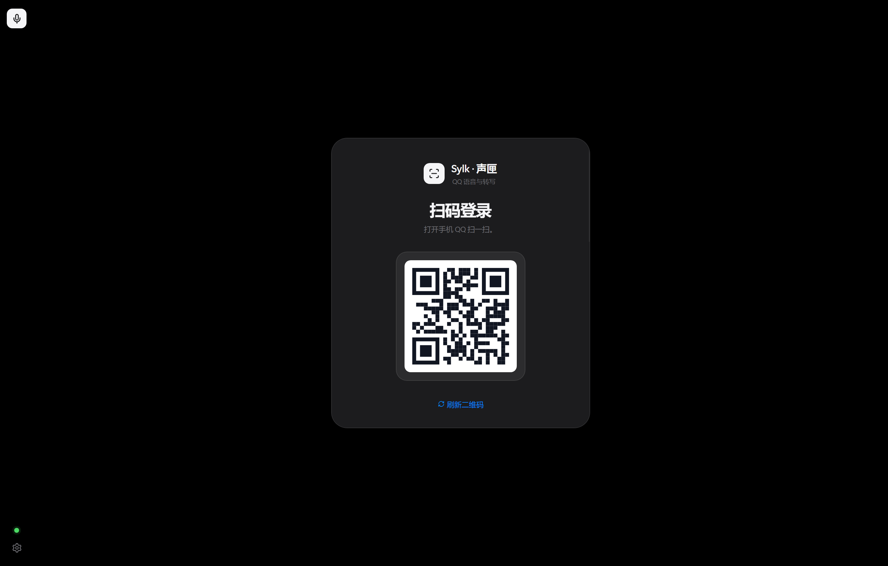
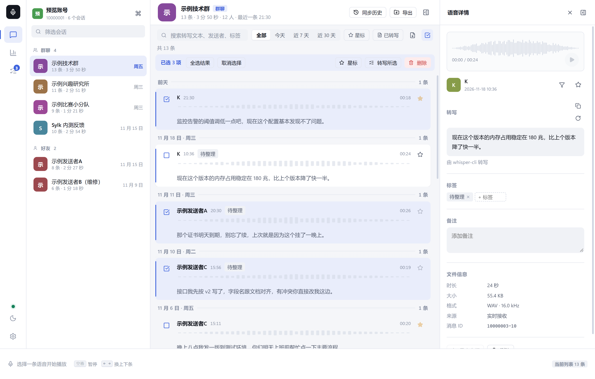

<div align="center">


# Sylk · 声匣

把 QQ 群聊与私聊里的语音存到本地，转成文字，能搜、能整理、能导出。

[](https://github.com/nebula-eng/sylk/releases/latest)
[](https://github.com/nebula-eng/sylk/actions/workflows/ci.yml)
[](LICENSE)
[](https://tauri.app)

**[下载 Windows 安装包](https://github.com/nebula-eng/sylk/releases/latest)** ·
[5 分钟快速开始](docs/quickstart.md) ·
Windows 10 2004+ / Windows 11 · x64 · 约 3 MB · 当前用户安装，不需要管理员权限

</div>

## 它解决什么问题

QQ 的语音只能在线听。换台设备、清一次缓存、过一阵子，那条语音就没了。群里有人用语音交代了一件事，等你想找，只剩一行「[语音]」。

Sylk 把你能听到的语音存成文件。登录用你自己的账号，能读到的范围和手机 QQ 上看到的一样。

## 三步开始

1. **安装 Sylk**：下载上面的安装包，双击安装。安装包没有签名，Windows 可能提示「未知发布者」，点「更多信息 → 仍要运行」。
2. **准备一个引擎**：Sylk 不内置第三方引擎。如果你已经有兼容引擎包或 NapCat 目录，打开 Sylk 后点「自动查找本机引擎」，或手动指定目录、导入 zip。
3. **扫码登录**：用手机 QQ 扫二维码并确认；之后在会话里点「同步」拉取语音。

> 唯一需要自备的是第三方引擎：许可不允许随仓库或安装包分发，上游下载源也已失效。
> 获取渠道、目录结构和组装方式见 [`docs/engine.md`](docs/engine.md)，完整步骤见
> [`docs/quickstart.md`](docs/quickstart.md)。

## 本机转写（可选）

语音归档、播放和导出不需要转写。需要转文字时，再准备 whisper.cpp：

1. **安装版用户**：在 PowerShell 里运行

   ```powershell
   $s = "$env:TEMP\setup-asr.ps1"
   Invoke-WebRequest https://raw.githubusercontent.com/nebula-eng/sylk/main/scripts/setup-asr.ps1 -OutFile $s
   powershell -ExecutionPolicy Bypass -File $s
   ```

   脚本会把 `whisper-cli.exe`、依赖 DLL 和 `ggml-base.bin` 下载到
   `%LOCALAPPDATA%\Sylk\tools`。

2. **源码用户**：在仓库目录运行 `npm run setup:asr`。

3. 打开 Sylk → 设置 → 转写，启用即可。不需要手填路径；Sylk 会自动识别
   `%LOCALAPPDATA%\Sylk\tools`。

默认是 `base` 模型（约 141 MB）；中文要求更高时运行
`scripts/setup-asr.ps1 -Model small`（约 466 MB）或 `-Model medium`。
GitHub 仓库和安装包都不包含 whisper 二进制或模型，只有上面的下载脚本。
详细说明见 [`docs/quickstart.md`](docs/quickstart.md#可选本机转写)。

## 功能

- **归档**：实时接收新语音；按会话同步历史，只挑语音段；拿不到 WAV 时保留 `.silk` 原件。
- **播放**：波形、拖动定位、0.75×–2× 倍速、单曲循环；键盘 `↑↓` 选条目、`Enter` 播放、`← →` 换上下条、`空格` 暂停、`S` 星标。
- **转写**：本机 `whisper-cli`，或任意 OpenAI 兼容接口；后台逐条执行，失败原因写进任务队列，改好配置可重试。
- **整理**：星标、标签、备注；按时间或发送者筛选；多选批量星标、转写、删除。
- **搜索**：在当前会话内搜文字稿、发送者、标签；会话列表可单独筛选。
- **统计**：会话时长排行、发送者排行、7×24 活跃热力图；点排行直接跳到对应语音。
- **导出**：单条音频；整个会话（音频 + `manifest.json` + `transcript.md` + `index.csv` + 离线 `archive.html`）。

## 界面

| 语音列表 | 语音详情 |
|---|---|
|  |  |

| 统计 | 任务队列 |
|---|---|
|  |  |

| 引擎设置 | 转写设置 |
|---|---|
|  |  |

| 深色主题 | 登录页 |
|---|---|
|  |  |

| 时间筛选 | 多选操作 |
|---|---|
|  |  |

## 文档

| 文档 | 内容 |
|---|---|
| [`docs/quickstart.md`](docs/quickstart.md) | 安装、引擎接入、扫码、第一次同步、常见错误 |
| [`docs/engine.md`](docs/engine.md) | 三种引擎接入方式、目录识别、获取与组装、排错 |
| [`docs/source-build.md`](docs/source-build.md) | 从源码构建、开发模式、无 QQ 的 mock 全链路 |
| [`docs/faq.md`](docs/faq.md) | 安装、引擎、同步、转写、数据清理的完整问答 |
| [`docs/privacy.md`](docs/privacy.md) | 数据清单、出网请求、密钥与日志、删除范围与边界 |
| [`docs/architecture.md`](docs/architecture.md) | 前后端结构、事件、错误处理与隐私层 |
| [`docs/releasing.md`](docs/releasing.md) | 版本号、构建、打 tag 与发布检查清单 |
| [`SECURITY.md`](SECURITY.md) | 威胁模型与安全问题报告方式 |
| [`CONTRIBUTING.md`](CONTRIBUTING.md) | 提交范围、构建与测试要求 |
| [`CHANGELOG.md`](CHANGELOG.md) | 版本记录 |

## 常见问题（节选）

**双击安装包，Windows 提示「未知发布者」？**
安装包没有代码签名，这是预期行为。点「更多信息 → 仍要运行」。如果公司电脑有软件白名单，需要先让 IT 放行。

**打开后提示没有引擎 / 自动查找找不到？**
Sylk 不内置引擎，需要兼容引擎包或 NapCat 目录。放在下载、桌面、文档或盘符根目录会被自动找到；放在别处就用「指定引擎目录」直接选。获取与组装见 [`docs/engine.md`](docs/engine.md)。

**二维码是空白的，或者一直「正在启动」？**
快速登录卡住时，Sylk 会在 60 秒后自动改用扫码登录；也可以点一次「刷新二维码」。不要连续重启引擎，避免触发腾讯风控。

**扫码提示「当前扫码操作存在安全风险」？**
这是腾讯账号侧的风控，不是 Sylk 报错。先停引擎，等 10–30 分钟，再用手机 QQ 在常用网络下扫一次。

**语音显示「音频还没下载」？**
去任务队列看失败原因，多数是 QQ 语音链接过期。点「重试失败」或重新同步该会话。

更多问题见 [`docs/faq.md`](docs/faq.md)。

## 隐私与数据

- 语音、转写文本、数据库和引擎登录态默认只保存在本机；没有遥测，不向项目服务器回传内容。
- 出网请求只有五类：QQ 登录与消息、语音下载（QQ CDN）、群/好友头像加载（`*.qlogo.cn`）、你主动开启的云端转写、你手动触发的引擎包下载。
- 云端转写的 API Key 用 Windows DPAPI 加密后写入设置文件；引擎令牌每次启动随机生成，只监听 `127.0.0.1`。
- 设置 → 隐私提供截屏防护、按天自动清理、一键清除本机数据；日志默认保留 14 天并做脱敏。
- 数据库是明文 SQLite，依赖 Windows 账户隔离；需要更强保护时把应用数据目录放到 BitLocker / EFS 加密磁盘。

完整说明见 [`docs/privacy.md`](docs/privacy.md)，安全边界见 [`SECURITY.md`](SECURITY.md)。

## 想改代码

需要 Node.js 20+、Rust 1.80+、VS Build Tools（勾「使用 C++ 的桌面开发」）和 WebView2 运行时。

```bash
git clone https://github.com/nebula-eng/sylk.git
cd sylk
build.cmd
```

首次约 5–10 分钟，之后增量构建约 1 分钟。更细的开发、调试、无 QQ mock 全链路和检查命令见 [`docs/source-build.md`](docs/source-build.md)。

## 第三方与许可

- Sylk 自己的代码使用 [MIT](LICENSE)。
- NapCat、V8 兼容引擎包及 QQ 客户端属于各自的第三方项目，不在本仓库或安装包中分发；使用前请自行确认许可与账号风险。
- QQ 是腾讯的商标，本项目与腾讯及 NapCat 维护者没有隶属关系。
