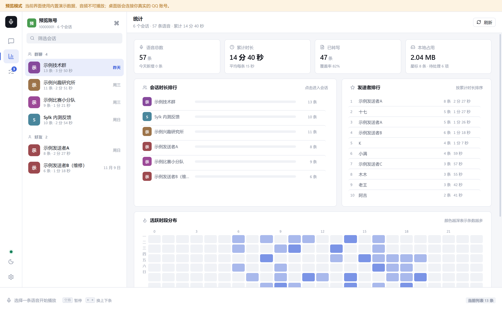
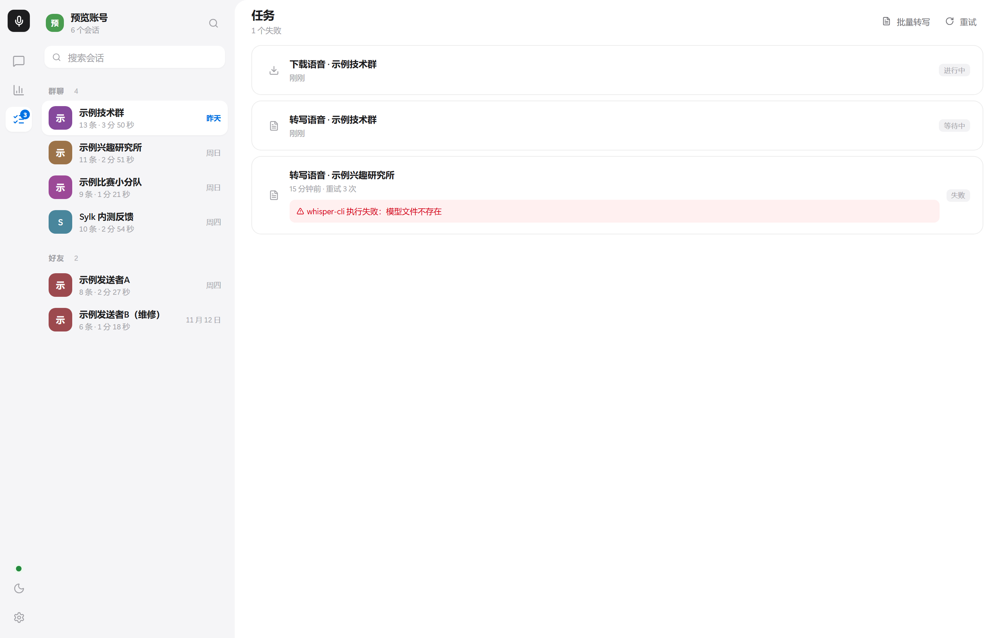
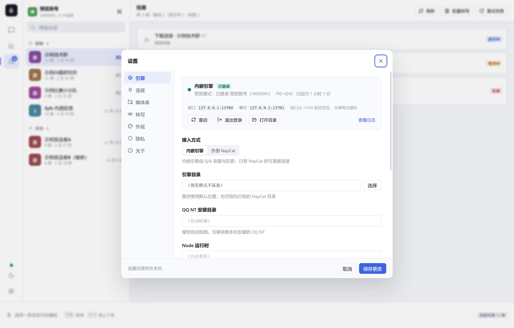
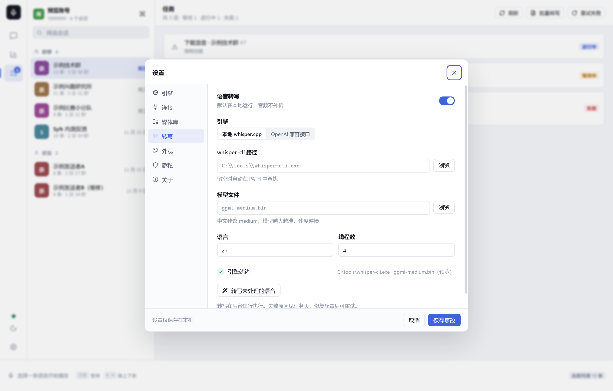
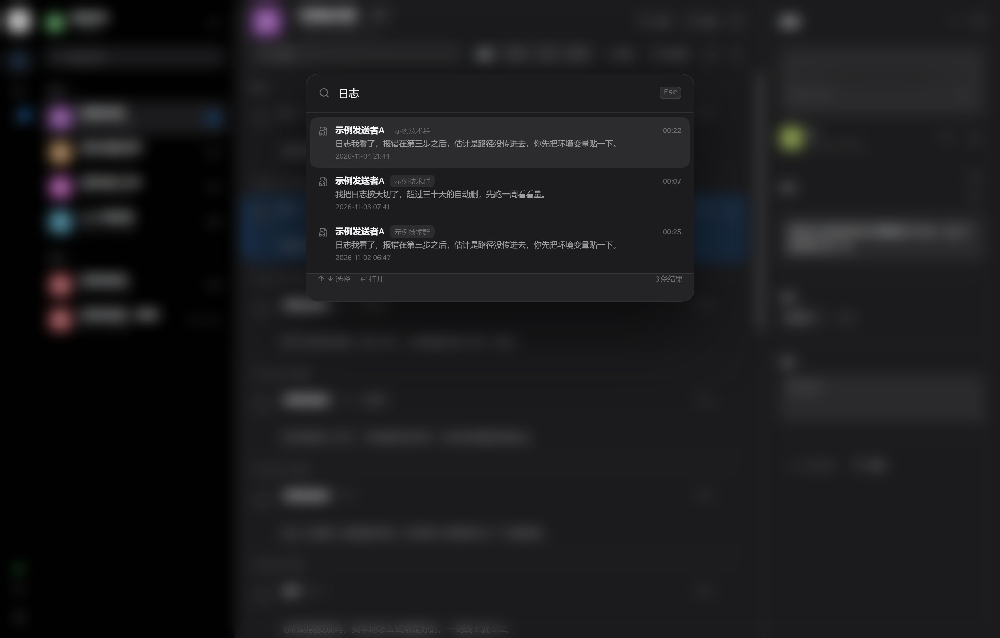

<div align="center">


# Sylk 路 澹板專

鎶?QQ 缇よ亰涓庣鑱婇噷鐨勮闊冲瓨鍒版湰鍦帮紝杞垚鏂囧瓧锛岃兘鎼溿€佽兘鏁寸悊銆佽兘瀵煎嚭銆?
[](https://github.com/nebula-eng/sylk/releases/latest)
[](https://github.com/nebula-eng/sylk/actions/workflows/ci.yml)
[](LICENSE)
[](https://tauri.app)

**[涓嬭浇 Windows 瀹夎鍖匽(https://github.com/nebula-eng/sylk/releases/latest)** 路
[5 鍒嗛挓蹇€熷紑濮媇(docs/quickstart.md) 路
Windows 10 2004+ / Windows 11 路 x64 路 绾?3 MB 路 褰撳墠鐢ㄦ埛瀹夎锛屼笉闇€瑕佺鐞嗗憳鏉冮檺

</div>

## 瀹冭В鍐充粈涔堥棶棰?
QQ 鐨勮闊冲彧鑳藉湪绾垮惉銆傛崲鍙拌澶囥€佹竻涓€娆＄紦瀛樸€佽繃涓€闃靛瓙锛岄偅鏉¤闊冲氨娌′簡銆傜兢閲屾湁浜虹敤璇煶浜や唬浜嗕竴浠朵簨锛岀瓑浣犳兂鎵撅紝鍙墿涓€琛屻€孾璇煶]銆嶃€?
Sylk 鎶婁綘鑳藉惉鍒扮殑璇煶瀛樻垚鏂囦欢銆傜櫥褰曠敤浣犺嚜宸辩殑璐﹀彿锛岃兘璇诲埌鐨勮寖鍥村拰鎵嬫満 QQ 涓婄湅鍒扮殑涓€鏍枫€?
## 涓夋寮€濮?
1. **瀹夎 Sylk**锛氫笅杞戒笂闈㈢殑瀹夎鍖咃紝鍙屽嚮瀹夎銆傚畨瑁呭寘娌℃湁绛惧悕锛學indows 鍙兘鎻愮ず銆屾湭鐭ュ彂甯冭€呫€嶏紝鐐广€屾洿澶氫俊鎭?鈫?浠嶈杩愯銆嶃€?2. **鍑嗗涓€涓紩鎿?*锛歋ylk 涓嶅唴缃涓夋柟寮曟搸銆傚鏋滀綘宸茬粡鏈夊吋瀹瑰紩鎿庡寘鎴?NapCat 鐩綍锛屾墦寮€ Sylk 鍚庣偣銆岃嚜鍔ㄦ煡鎵炬湰鏈哄紩鎿庛€嶏紝鎴栨墜鍔ㄦ寚瀹氱洰褰曘€佸鍏?zip銆?3. **鎵爜鐧诲綍**锛氱敤鎵嬫満 QQ 鎵簩缁寸爜骞剁‘璁わ紱涔嬪悗鍦ㄤ細璇濋噷鐐广€屽悓姝ャ€嶆媺鍙栬闊炽€?
> 鍞竴闇€瑕佽嚜澶囩殑鏄涓夋柟寮曟搸锛氳鍙笉鍏佽闅忎粨搴撴垨瀹夎鍖呭垎鍙戯紝涓婃父涓嬭浇婧愪篃宸插け鏁堛€?> 鑾峰彇娓犻亾銆佺洰褰曠粨鏋勫拰缁勮鏂瑰紡瑙?[`docs/engine.md`](docs/engine.md)锛屽畬鏁存楠よ
> [`docs/quickstart.md`](docs/quickstart.md)銆?
## 鏈満杞啓锛堝彲閫夛級

璇煶褰掓。銆佹挱鏀惧拰瀵煎嚭涓嶉渶瑕佽浆鍐欍€傞渶瑕佽浆鏂囧瓧鏃讹紝鍐嶅噯澶?whisper.cpp锛?
1. **瀹夎鐗堢敤鎴?*锛氬湪 PowerShell 閲岃繍琛?
   ```powershell
   $s = "$env:TEMP\setup-asr.ps1"
   Invoke-WebRequest https://cdn.jsdelivr.net/gh/nebula-eng/sylk@2dfe0df/scripts/setup-asr.ps1 -OutFile $s
   powershell -ExecutionPolicy Bypass -File $s
   ```

   濡傛灉涓嬭浇澶辫触锛屼篃鍙互鎵撳紑浠撳簱閲岀殑
   [`scripts/setup-asr.ps1`](scripts/setup-asr.ps1)锛屽鍒跺唴瀹瑰埌鏈満 `.ps1` 鍚庤繍琛屻€?   鑴氭湰浼氫紭鍏堢洿杩?GitHub锛涘け璐ユ椂鑷姩鏀圭敤闀滃儚涓嬭浇杩愯鏃讹紝妯″瀷浼樺厛璧?hf-mirror銆?
   鑴氭湰浼氭妸 `whisper-cli.exe`銆佷緷璧?DLL 鍜?`ggml-base.bin` 涓嬭浇鍒?   `%LOCALAPPDATA%\Sylk\tools`銆?
2. **婧愮爜鐢ㄦ埛**锛氬湪浠撳簱鐩綍杩愯 `npm run setup:asr`銆?
3. 鎵撳紑 Sylk 鈫?璁剧疆 鈫?杞啓锛屽惎鐢ㄥ嵆鍙€備笉闇€瑕佹墜濉矾寰勶紱Sylk 浼氳嚜鍔ㄨ瘑鍒?   `%LOCALAPPDATA%\Sylk\tools`銆?
榛樿鏄?`base` 妯″瀷锛堢害 141 MB锛夛紱涓枃瑕佹眰鏇撮珮鏃惰繍琛?`scripts/setup-asr.ps1 -Model small`锛堢害 466 MB锛夋垨 `-Model medium`銆?GitHub 浠撳簱鍜屽畨瑁呭寘閮戒笉鍖呭惈 whisper 浜岃繘鍒舵垨妯″瀷锛屽彧鏈変笂闈㈢殑涓嬭浇鑴氭湰銆?璇︾粏璇存槑瑙?[`docs/quickstart.md`](docs/quickstart.md#鍙€夋湰鏈鸿浆鍐?銆?
## 鍔熻兘

- **褰掓。**锛氬疄鏃舵帴鏀舵柊璇煶锛涙寜浼氳瘽鍚屾鍘嗗彶锛屽彧鎸戣闊虫锛涙嬁涓嶅埌 WAV 鏃朵繚鐣?`.silk` 鍘熶欢銆?- **鎾斁**锛氭尝褰€佹嫋鍔ㄥ畾浣嶃€?.75脳鈥?脳 鍊嶉€熴€佸崟鏇插惊鐜紱閿洏 `鈫戔啌` 閫夋潯鐩€乣Enter` 鎾斁銆乣鈫?鈫抈 鎹笂涓嬫潯銆乣绌烘牸` 鏆傚仠銆乣S` 鏄熸爣銆?- **杞啓**锛氭湰鏈?`whisper-cli`锛屾垨浠绘剰 OpenAI 鍏煎鎺ュ彛锛涘悗鍙伴€愭潯鎵ц锛屽け璐ュ師鍥犲啓杩涗换鍔￠槦鍒楋紝鏀瑰ソ閰嶇疆鍙噸璇曘€?- **鏁寸悊**锛氭槦鏍囥€佹爣绛俱€佸娉紱鎸夋椂闂存垨鍙戦€佽€呯瓫閫夛紱澶氶€夋壒閲忔槦鏍囥€佽浆鍐欍€佸垹闄ゃ€?- **鎼滅储**锛氬湪褰撳墠浼氳瘽鍐呮悳鏂囧瓧绋裤€佸彂閫佽€呫€佹爣绛撅紱浼氳瘽鍒楄〃鍙崟鐙瓫閫夈€?- **缁熻**锛氫細璇濇椂闀挎帓琛屻€佸彂閫佽€呮帓琛屻€?脳24 娲昏穬鐑姏鍥撅紱鐐规帓琛岀洿鎺ヨ烦鍒板搴旇闊炽€?- **瀵煎嚭**锛氬崟鏉￠煶棰戯紱鏁翠釜浼氳瘽锛堥煶棰?+ `manifest.json` + `transcript.md` + `index.csv` + 绂荤嚎 `archive.html`锛夈€?
## 鐣岄潰

| 璇煶鍒楄〃 | 璇煶璇︽儏 |
|---|---|
|  |  |

| 缁熻 | 浠诲姟闃熷垪 |
|---|---|
|  |  |

| 寮曟搸璁剧疆 | 杞啓璁剧疆 |
|---|---|
|  |  |

| 娣辫壊涓婚 | 鐧诲綍椤?|
|---|---|
|  |  | 瀹夎銆佸紩鎿庢帴鍏ャ€佹壂鐮併€佺涓€娆″悓姝ャ€佸父瑙侀敊璇?|
| [`docs/engine.md`](docs/engine.md) | 涓夌寮曟搸鎺ュ叆鏂瑰紡銆佺洰褰曡瘑鍒€佽幏鍙栦笌缁勮銆佹帓閿?|
| [`docs/source-build.md`](docs/source-build.md) | 浠庢簮鐮佹瀯寤恒€佸紑鍙戞ā寮忋€佹棤 QQ 鐨?mock 鍏ㄩ摼璺?|
| [`docs/faq.md`](docs/faq.md) | 瀹夎銆佸紩鎿庛€佸悓姝ャ€佽浆鍐欍€佹暟鎹竻鐞嗙殑瀹屾暣闂瓟 |
| [`docs/privacy.md`](docs/privacy.md) | 鏁版嵁娓呭崟銆佸嚭缃戣姹傘€佸瘑閽ヤ笌鏃ュ織銆佸垹闄よ寖鍥翠笌杈圭晫 |
| [`docs/architecture.md`](docs/architecture.md) | 鍓嶅悗绔粨鏋勩€佷簨浠躲€侀敊璇鐞嗕笌闅愮灞?|
| [`docs/releasing.md`](docs/releasing.md) | 鐗堟湰鍙枫€佹瀯寤恒€佹墦 tag 涓庡彂甯冩鏌ユ竻鍗?|
| [`SECURITY.md`](SECURITY.md) | 濞佽儊妯″瀷涓庡畨鍏ㄩ棶棰樻姤鍛婃柟寮?|
| [`CONTRIBUTING.md`](CONTRIBUTING.md) | 鎻愪氦鑼冨洿銆佹瀯寤轰笌娴嬭瘯瑕佹眰 |
| [`CHANGELOG.md`](CHANGELOG.md) | 鐗堟湰璁板綍 |

## 甯歌闂锛堣妭閫夛級

**鍙屽嚮瀹夎鍖咃紝Windows 鎻愮ず銆屾湭鐭ュ彂甯冭€呫€嶏紵**
瀹夎鍖呮病鏈変唬鐮佺鍚嶏紝杩欐槸棰勬湡琛屼负銆傜偣銆屾洿澶氫俊鎭?鈫?浠嶈杩愯銆嶃€傚鏋滃叕鍙哥數鑴戞湁杞欢鐧藉悕鍗曪紝闇€瑕佸厛璁?IT 鏀捐銆?
**鎵撳紑鍚庢彁绀烘病鏈夊紩鎿?/ 鑷姩鏌ユ壘鎵句笉鍒帮紵**
Sylk 涓嶅唴缃紩鎿庯紝闇€瑕佸吋瀹瑰紩鎿庡寘鎴?NapCat 鐩綍銆傛斁鍦ㄤ笅杞姐€佹闈€佹枃妗ｆ垨鐩樼鏍圭洰褰曚細琚嚜鍔ㄦ壘鍒帮紱鏀惧湪鍒灏辩敤銆屾寚瀹氬紩鎿庣洰褰曘€嶇洿鎺ラ€夈€傝幏鍙栦笌缁勮瑙?[`docs/engine.md`](docs/engine.md)銆?
**浜岀淮鐮佹槸绌虹櫧鐨勶紝鎴栬€呬竴鐩淬€屾鍦ㄥ惎鍔ㄣ€嶏紵**
蹇€熺櫥褰曞崱浣忔椂锛孲ylk 浼氬湪 60 绉掑悗鑷姩鏀圭敤鎵爜鐧诲綍锛涗篃鍙互鐐逛竴娆°€屽埛鏂颁簩缁寸爜銆嶃€備笉瑕佽繛缁噸鍚紩鎿庯紝閬垮厤瑙﹀彂鑵捐椋庢帶銆?
**鎵爜鎻愮ず銆屽綋鍓嶆壂鐮佹搷浣滃瓨鍦ㄥ畨鍏ㄩ闄┿€嶏紵**
杩欐槸鑵捐璐﹀彿渚х殑椋庢帶锛屼笉鏄?Sylk 鎶ラ敊銆傚厛鍋滃紩鎿庯紝绛?10鈥?0 鍒嗛挓锛屽啀鐢ㄦ墜鏈?QQ 鍦ㄥ父鐢ㄧ綉缁滀笅鎵竴娆°€?
**璇煶鏄剧ず銆岄煶棰戣繕娌′笅杞姐€嶏紵**
鍘讳换鍔￠槦鍒楃湅澶辫触鍘熷洜锛屽鏁版槸 QQ 璇煶閾炬帴杩囨湡銆傜偣銆岄噸璇曞け璐ャ€嶆垨閲嶆柊鍚屾璇ヤ細璇濄€?
鏇村闂瑙?[`docs/faq.md`](docs/faq.md)銆?
## 闅愮涓庢暟鎹?
- 璇煶銆佽浆鍐欐枃鏈€佹暟鎹簱鍜屽紩鎿庣櫥褰曟€侀粯璁ゅ彧淇濆瓨鍦ㄦ湰鏈猴紱娌℃湁閬ユ祴锛屼笉鍚戦」鐩湇鍔″櫒鍥炰紶鍐呭銆?- 鍑虹綉璇锋眰鍙湁浜旂被锛歈Q 鐧诲綍涓庢秷鎭€佽闊充笅杞斤紙QQ CDN锛夈€佺兢/濂藉弸澶村儚鍔犺浇锛坄*.qlogo.cn`锛夈€佷綘涓诲姩寮€鍚殑浜戠杞啓銆佷綘鎵嬪姩瑙﹀彂鐨勫紩鎿庡寘涓嬭浇銆?- 浜戠杞啓鐨?API Key 鐢?Windows DPAPI 鍔犲瘑鍚庡啓鍏ヨ缃枃浠讹紱寮曟搸浠ょ墝姣忔鍚姩闅忔満鐢熸垚锛屽彧鐩戝惉 `127.0.0.1`銆?- 璁剧疆 鈫?闅愮鎻愪緵鎴睆闃叉姢銆佹寜澶╄嚜鍔ㄦ竻鐞嗐€佷竴閿竻闄ゆ湰鏈烘暟鎹紱鏃ュ織榛樿淇濈暀 14 澶╁苟鍋氳劚鏁忋€?- 鏁版嵁搴撴槸鏄庢枃 SQLite锛屼緷璧?Windows 璐︽埛闅旂锛涢渶瑕佹洿寮轰繚鎶ゆ椂鎶婂簲鐢ㄦ暟鎹洰褰曟斁鍒?BitLocker / EFS 鍔犲瘑纾佺洏銆?
瀹屾暣璇存槑瑙?[`docs/privacy.md`](docs/privacy.md)锛屽畨鍏ㄨ竟鐣岃 [`SECURITY.md`](SECURITY.md)銆?
## 鎯虫敼浠ｇ爜

闇€瑕?Node.js 20+銆丷ust 1.80+銆乂S Build Tools锛堝嬀銆屼娇鐢?C++ 鐨勬闈㈠紑鍙戙€嶏級鍜?WebView2 杩愯鏃躲€?
```bash
git clone https://github.com/nebula-eng/sylk.git
cd sylk
build.cmd
```

棣栨绾?5鈥?0 鍒嗛挓锛屼箣鍚庡閲忔瀯寤虹害 1 鍒嗛挓銆傛洿缁嗙殑寮€鍙戙€佽皟璇曘€佹棤 QQ mock 鍏ㄩ摼璺拰妫€鏌ュ懡浠よ [`docs/source-build.md`](docs/source-build.md)銆?
## 绗笁鏂逛笌璁稿彲

- Sylk 鑷繁鐨勪唬鐮佷娇鐢?[MIT](LICENSE)銆?- NapCat銆乂8 鍏煎寮曟搸鍖呭強 QQ 瀹㈡埛绔睘浜庡悇鑷殑绗笁鏂归」鐩紝涓嶅湪鏈粨搴撴垨瀹夎鍖呬腑鍒嗗彂锛涗娇鐢ㄥ墠璇疯嚜琛岀‘璁よ鍙笌璐﹀彿椋庨櫓銆?- QQ 鏄吘璁殑鍟嗘爣锛屾湰椤圭洰涓庤吘璁強 NapCat 缁存姢鑰呮病鏈夐毝灞炲叧绯汇€?
