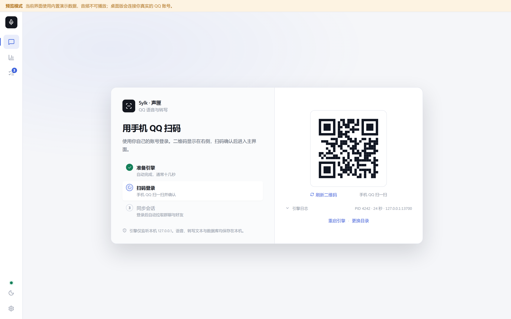
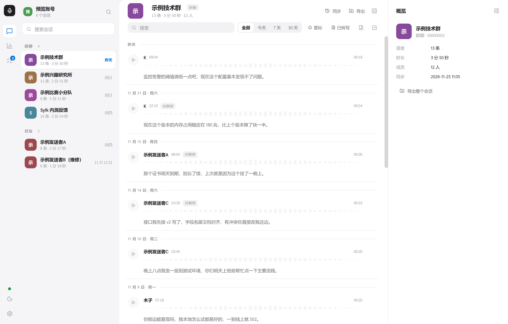
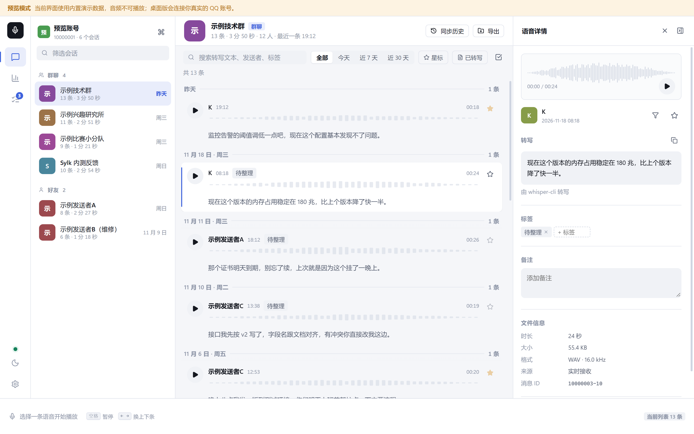
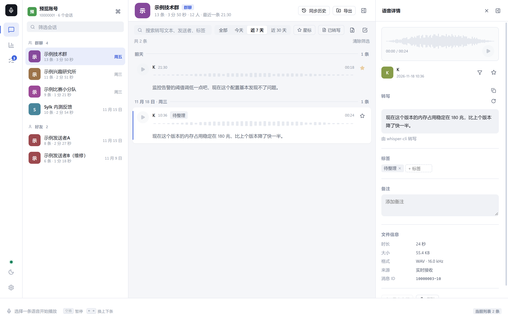

<div align="center">



# Sylk

QQ 语音归档工具。把群聊和私聊里的语音存到本地，转成文字，能搜、能整理、能导出。

[](https://github.com/nebula-eng/sylk/actions/workflows/ci.yml)
[](https://github.com/nebula-eng/sylk/releases)
[](LICENSE)
[](https://tauri.app)
[](src-tauri)

</div>

## 最快开始

| 你的情况 | 做什么 |
|---|---|
| 只想用 | 从 Releases 下载约 3 MB 的安装包 → 打开 → 引擎页「自动查找本机引擎」，或「指定引擎目录 / 导入引擎包」→ 手机 QQ 扫码 |
| 想改代码 | 双击 `build.cmd`（首次约 10 分钟）→ 装好后同上接入引擎 |

唯一需要自备的是第三方引擎：许可不允许随仓库或安装包分发，上游下载源也已失效。
两条安装路径都不含引擎，原因和三种接入方式写在 [`docs/quickstart.md`](docs/quickstart.md)。

## 为什么做这个

QQ 的语音只能在线听。换台设备、清一次缓存、过一阵子，那条语音就没了。群里有人用语音交代了一件事，等你想找，只剩一行「[语音]」。

Sylk 把你能听到的语音存成文件。登录用你自己的账号，能读到的范围和手机 QQ 上看到的一样。

## 状态与运行要求

| | |
|---|---|
| 当前版本 | 0.2.4，Windows x64 |
| 系统 | Windows 10 2004+ / Windows 11；需要 WebView2 运行时 |
| 权限 | 当前用户安装，不需要管理员权限 |
| 引擎 | 不内置，首次使用按 [`docs/quickstart.md`](docs/quickstart.md) 接入 |
| 数据 | 默认全部保存在本机；无遥测；详细清单见 [`docs/privacy.md`](docs/privacy.md) |

## 文档

| 文档 | 内容 |
|---|---|
| [`docs/quickstart.md`](docs/quickstart.md) | 两条最短使用路径、引擎包结构、常见启动问题 |
| [`docs/engine.md`](docs/engine.md) | 四种引擎接入方式、目录结构、V8 兼容模式 |
| [`docs/architecture.md`](docs/architecture.md) | 前后端结构、事件、错误处理与隐私层 |
| [`docs/privacy.md`](docs/privacy.md) | 数据清单、出网请求、密钥与日志、删除范围与边界 |
| [`SECURITY.md`](SECURITY.md) | 威胁模型与安全问题报告方式 |
| [`CONTRIBUTING.md`](CONTRIBUTING.md) | 构建、提交范围、测试要求 |
| [`CHANGELOG.md`](CHANGELOG.md) | 版本记录 |

## 仓库结构

```
sylk/
├─ src/                 前端（React 19 + TypeScript + zustand）
│  ├─ components/       界面组件
│  └─ lib/              API 封装、store、类型
├─ src-tauri/           Rust 后端（Tauri 2）
│  ├─ src/              命令、数据库、引擎托管、隐私层
│  └─ engine/           第三方引擎说明（不放二进制）
├─ scripts/             构建、安装、截图与端到端检查
├─ docs/                文档与界面截图
└─ .github/             CI、Release、Issue/PR 模板
```

## 从源码构建

先把仓库拉下来，然后**双击 `build.cmd`**。代码部分就这一步。

它会依次做五件事：检查工具链 → 装依赖 → 编译（前端、Rust、安装包）→ 装到你的账户 → 建桌面快捷方式。
第一次约 10 分钟（Rust 要把所有依赖编一遍），中间长时间没输出是正常的。之后改代码再编只要 3–4 分钟。
装好应用本身不含引擎，首次启动按 [`docs/quickstart.md`](docs/quickstart.md) 接入一个引擎。

命令行里跑等价：

```bash
npm run setup              # 编译 + 安装
npm run setup -- --check   # 只检查环境，不动任何东西
npm run setup -- --dist    # 只出安装包，不装本机（给别人分发）
```

装到 `%LOCALAPPDATA%\Sylk`，当前用户模式，不需要管理员权限，带卸载程序。

之后打开它：**双击桌面图标，或开始菜单搜「Sylk」**，约 1 秒出界面。没有“启动开发服务器”这回事。

### 需要先有什么

| | 说明 |
|---|---|
| [Node.js](https://nodejs.org/) 20+ | 装 LTS 版即可 |
| [Rust](https://rustup.rs/) | `winget install Rustlang.Rustup` |
| [VS Build Tools](https://visualstudio.microsoft.com/downloads/) | 勾选「使用 C++ 的桌面开发」 |
| [WebView2 运行时](https://developer.microsoft.com/microsoft-edge/webview2/) | Windows 11 自带，Win10 可能要装 |

缺哪样，`build.cmd` 会直接告诉你缺什么、去哪儿装，不会编译到一半才报错。系统级 SDK 不替用户静默安装——那是几百 MB 的东西，该由你自己决定装不装。

### 为什么不是下载一个 exe

可以。仓库带 GitHub Actions 打包流程（`.github/workflows/release.yml`），打 tag 时会自动产出安装包挂到 Releases。
直接下载安装包的话，不需要 Node/Rust/VS Build Tools。
两条路都不包含引擎：第三方引擎包受许可限制，上游下载源也已失效，不进仓库也不进安装包（见
[`src-tauri/engine/README.md`](src-tauri/engine/README.md)）。首次使用按 [`docs/quickstart.md`](docs/quickstart.md)
接入一个引擎，之后就是双击图标即用。

## 用法

打开之后，Sylk 会拉起引擎并显示二维码，手机 QQ 扫码确认即可。之后在会话里点「同步历史」，
语音会一条条落到本地。

引擎有三种来源，按你的情况选一种：

| 你的情况 | 选法 |
|---|---|
| 本机装有 QQ，且版本在引擎支持范围内 | 登录页「下载并启动」（内置包/自备引擎包） |
| 有 V8 兼容引擎包（适配 QQ 9.9.37+） | 设置 → 引擎 → 「QQ NT 安装目录」指向该便携目录，登录页点「启动引擎」 |
| 已经跑着别的 OneBot 实现 | 设置 → 引擎 → 接入方式改成「连接已有 NapCat」，填地址和令牌 |

> **2026-11 之后的新版 QQ 无法用经典注入。** QQ 9.9.37-54395 起给关键文件加了签名校验，
> 旧式 NapCat 注入会弹「文件已损坏」并退出。Sylk 已支持 **V8 兼容引擎包**（社区用 V8
> 编译期注入绕过文件校验的方案），但这类引擎包与 QQ 副本都受第三方许可限制，仓库和安装包
> **都不会附带**，需要你自己准备或按 `src-tauri/engine/README.md` 组装一个便携目录。
>
> **内置下载源可能失效。** 上游 NapCat 已于 2026-11-12 清空，内置下载地址大概率不可用。
> 拿不到时 Sylk 会明确写出失败原因，并把三条手动路径摆出来；下载源可以在
> 「设置 → 引擎」里换成你自己的镜像。

关闭窗口默认最小化到托盘；已经开着的时候再双击图标，0.08 秒把窗口唤回前台，不会起第二个进程。

第一次准备时会下载或解压一份引擎到应用数据目录。之后的启动、配置、退出清理都归 Sylk 管。
你只需要看着一个程序。

> 前提是本机装了 QQ NT。引擎靠注入 QQ 工作，这一点绕不过去。Sylk 不会替你装腾讯的客户端。

想用别的接入方式也行：

- 已经有一份解压好的 NapCat → 登录页点「指定已有目录」，只校验入口，不动文件
- 手上是 zip 包 → 「导入压缩包」
- 在别处跑着一套（比如服务器上） → 设置 → 引擎 → 接入方式改成「连接已有 NapCat」，填地址和令牌


## 功能

**归档**

- 实时收新语音
- 按会话回溯历史，只挑语音段
- 拿不到 WAV 时保留 `.silk` 原件

**播放**

- 波形、拖动定位、0.75×–2× 倍速、单曲循环
- 键盘：`↑↓` 选条目，`Enter` 播放，`← →` 换上下条，`空格` 暂停，`S` 星标

**转写**

- 本机 `whisper-cli`，或者任意 OpenAI 兼容接口
- 后台一条条跑，失败原因写进任务队列，改好配置能重试

**整理**

- 星标、标签、备注
- 按时间筛（今天 / 近 7 天 / 近 30 天）
- 按发送者筛：详情面板点那个人旁边的漏斗；从统计页点也能筛，会自动跨会话
- 多选后批量星标、批量转写、批量删除

**搜索**

- 搜文字稿、发送者、会话名、标签、备注
- `Ctrl K` 从哪儿都能开

**统计**

- 会话时长排行、谁说得最多，点一行直接跳过去
- 7×24 活跃热力图，最近 30 天趋势

**导出**

- 单条音频
- 整个会话：音频 + `manifest.json` + `transcript.md` + `index.csv` + 一个能离线打开的 `archive.html`
- 当前筛选结果导成 CSV

## 界面

| 语音列表 | 语音详情 |
|---|---|
|  |  |

| 统计 | 任务队列 |
|---|---|
|  |  |

| 引擎设置 | 转写设置 |
|---|---|
|  |  |

| 时间筛选 | 多选操作 |
|---|---|
|  |  |

| 深色 | 深色登录页 |
|---|---|
|  |  |

## 文件放在哪

媒体库默认在「文档 / Sylk Library」，设置里可以改。

```
<媒体库>/
├─ audio/2026/11/20261120_143012_示例发送者.wav
├─ raw/2026/11/20261120_143012_示例发送者.silk      （可以关掉）
└─ exports/示例技术群/
   ├─ audio/*.wav
   ├─ manifest.json
   ├─ transcript.md
   ├─ index.csv
   └─ archive.html
```

索引数据库、设置、引擎在应用数据目录（Windows 是 `%APPDATA%\app.sylk.desktop`）；
日志在 `%LOCALAPPDATA%\app.sylk.desktop\logs`，默认保留 14 天。

## 隐私与数据

- 本地优先：语音、转写、数据库和引擎登录态默认只在这台电脑上；没有遥测，不向项目服务器
  回传任何内容。
- 出网的只有四类请求：QQ 登录与消息（腾讯服务器）、语音下载（QQ CDN）、你主动开启的云端
  转写接口、你手动触发的引擎包下载。用户填写的远程地址必须是 HTTPS，本机回环地址除外。
- 云端转写的 API Key 用 Windows DPAPI 加密后写入设置文件；引擎令牌每次启动随机生成，
  只监听 `127.0.0.1`。
- 引擎日志进入界面前会去掉访问令牌、Windows 用户目录和 QQ 号中间位；日志文件保留 14 天。
- 设置 → 隐私提供：截屏防护（Windows 10 2004+）、按 7/30/90 天自动清理、一键清除本机数据。
- 数据库是明文 SQLite，依赖 Windows 账户隔离；需要更强保护时把应用数据目录放到
  BitLocker / EFS 加密的磁盘上。

完整的数据清单、删除范围与未覆盖的风险见 [`docs/privacy.md`](docs/privacy.md)，
实现边界见 [`SECURITY.md`](SECURITY.md)。

## 几个技术选择

**登录不自己实现。** 协议和风控交给 NapCat —— 一个基于官方 NTQQ 的 OneBot 11 实现。Sylk 只用它的读接口：`get_group_list`、`get_group_msg_history`、`get_record`，不碰发消息和群管理。它升级协议时 Sylk 不用改。

**SILK 解码放在前端。** QQ 语音是 SILK v3，不是通用格式。靠 ffmpeg 的话，「装好就能用」就成了空话。Sylk 把 [silk-wasm](https://github.com/idranme/silk-wasm) 打进前端，在 WebView 里解码，Rust 负责写文件。跨平台不用装任何东西。

**下载有四条路。** 消息段里的本地路径 → NapCat 的 `get_record` → CDN 直链 → 引擎 `cache/` 目录。前三条是常规路径，第四条只有内嵌模式才有：Sylk 知道引擎装在哪，`get_record` 因为缺 ffmpeg 失败时能直接把原件捞出来。

**历史游标不盲信。** `get_group_msg_history` 在 `message_seq` 上的行为各版本不太一样，也不返回 `has_more`。所以翻页看三件事：这页有没有新消息、最旧的 id 有没有前进、这页是不是比请求的少。任何一项不对就停，宁可少翻几页也不死循环。

**上限在哪。** 语音列表一次取 500 条，靠 `content-visibility` 保持滚动流畅，再多就得上虚拟滚动。搜索是 `LIKE` 全表扫，十万级要换 FTS5。这些写在 `docs/architecture.md` 里，真遇到了按那个方向改。

## 设计规范

字号 8 级（10–24px）、圆角 5 级、间距按 4px 栅格，全部定义在 `src/styles/tokens.css`；
组件不写死数值，一律引用变量。所有控件共用 `--ctl-h`，所以同一行的搜索框、分段、筛选片高度一致。

改界面时先看 `tokens.css`，别在 `app.css` 里加新的字面量 —— 之前这里散落着 21 种字号和 12 种圆角，
是非专业人士也能一眼看出的乱。

## 从源码构建

要 Node 20+、Rust 1.80+。Windows 还要 MSVC Build Tools 和 WebView2 Runtime。

```bash
git clone https://github.com/<your-org>/sylk.git
cd sylk
npm install
npm run setup          # 检查环境 → 装依赖 → 编译 → 打包 → 装到本机 + 建桌面快捷方式
```

发布包不含第三方引擎（许可限制），需要的话用 `npm run setup -- --engine=<你的 NapCat.Shell.zip>`
单独打一个自用版。

不想装、只想跑一下：

```bash
npm run app:rel    # 只编不打包，产物在 src-tauri/target/release/sylk.exe
open.cmd           # 双击这个，或直接双击 exe
```

| 打开方式 | 命令返回 | 界面可点 |
|---|---|---|
| 桌面快捷方式 / 开始菜单 | 立即 | **约 1.0 秒** |
| `open.cmd` / 双击 target 里的 exe | 0.19 秒 | 约 1.0 秒 |
| `npm run app:open` | 2.5 秒 | 1.0 秒（2.5 秒里 1.5 秒是 npm 自身开销） |

改前端用 `npm run app:dev`（热更新）。改 Rust 才需要重新编译，一次十几秒。

`npm run startup` 会连续启动几次，把「从进程启动到首帧」的毫秒数打出来 —— 不用猜。

只想看界面、不启动 Rust：

```bash
npm run dev          # http://127.0.0.1:1420
```

浏览器里是演示数据，音频放不了，顶部有提示。想看登录页：控制台执行 `localStorage.setItem('sylk.preview.login','0')` 再刷新。

### 为什么不能只跑 `cargo build --release`

Tauri 靠 `custom-protocol` feature 决定前端从哪来：开着就把 `dist/` 打进二进制走自定义协议，关着就去连 `devUrl`（本机 1420）。`tauri dev` 会用 `--no-default-features` 关掉它，正式构建必须开着。这块在 `Cargo.toml` 里有注释，改 profile 名之前先看一眼 —— 自定义档名（比如 `release-fast`）不会被 tauri-build 认作发布模式，编出来的程序会去连 1420，装到别的机器上就是白屏。

### 没有 QQ 也能跑通全链路

仓库带了一个引擎替身。它会读 Sylk 写的配置、往 `cache/` 写二维码、按 NapCat 的格式打日志，所以验的是托管逻辑本身，不是一堆假数据。

```bash
npm run mock:prepare                            # 造一个假引擎目录
npm run app:rel                                 # 编 release
SYLK_CDP_PORT=9333 npm run app:open             # 带调试端口启动
npm run e2e:engine                              # 扫码→登录→回溯→解码→播放→重启→停止
npm run e2e:features                            # 筛选、批量、折叠、键盘
```

`SYLK_CDP_PORT` 只在需要自动化时用；平时启动不带它，WebView2 不会开调试端口。

只想验「连接外部 NapCat」那条路：`npm run mock`（HTTP 3000 / WS 3001）。

### 检查

```bash
cargo test --manifest-path src-tauri/Cargo.toml
cargo clippy --manifest-path src-tauri/Cargo.toml --all-targets -- -D warnings
npm run typecheck
npm run review           # 1440/1100/960 三个宽度下的溢出、重叠、文字裁剪
```

## 转写怎么配

Sylk 不带模型，只负责调度。

**本机 whisper.cpp**（推荐，不联网）

下载 `whisper-bin-x64.zip` 解压，再下模型 `ggml-medium.bin`。设置 → 转写里填 `whisper-cli.exe` 和模型路径，点一下检测。中文用 `medium` 比 `base` 准得多，CPU 上一条 10 秒的语音大概 2–4 秒。

**OpenAI 兼容接口**

任何实现了 `POST /audio/transcriptions` 的服务都行。适合没有本地算力的机器，代价是音频要发到那个服务。

## 常见问题

**会封号吗**
Sylk 自己不做协议层的事，但内嵌的引擎是第三方实现。腾讯什么态度没有保证。建议用小号，只在自己的机器上跑。

**「下载并启动」下的是什么**
NapCat 的官方发布包，解压到应用数据目录的 `engine/napcat`。引擎仍然需要本机装有 QQ NT —— 它靠注入 QQ 来读你能看到的内容，这一点绕不过去。

**为什么回溯只拿到最近的一批**
只能读到当前账号在客户端里还看得见的记录。超过服务器保留期的，任何工具都拿不回来。把设置里的「单个会话最多回溯页数」调大能多翻一些。

**引擎启动失败 / QQ 弹「文件已损坏」**
最常见的两个原因：

1. **QQ 与引擎版本不匹配。** 新版 QQ（9.9.37-54395 起）弃用了 `package.json.main` 并加了
   关键文件签名校验，旧的 NapCat 注入会被判成文件损坏。Sylk 在启动前会先比对引擎支持列表，
   不在列表里就不会注入，并在登录页写明两边版本。解决办法是用 V8 兼容引擎包（见
   `src-tauri/engine/README.md`），或把「QQ NT 安装目录」指向一个受支持的 QQ 便携目录。
2. **QQ 已经在运行。** 引擎需要自己启动 QQ。请先完全退出 QQ（包括托盘图标）再点重启。

日志在登录页底部「引擎日志」和设置 → 引擎里都能看到；环境自检会列出引擎文件、QQ 版本、
进程与登录状态。

**语音显示「音频还没下载」**
索引有这条，文件没落地。去任务队列看原因：多数是链接过期（QQ 的语音 URL 有时间限制），
或者引擎那侧缺 ffmpeg。修好点「重试失败」，或者重新连一次 —— 连接时会自动补下所有缺文件的条目。

**扫码提示「当前扫码操作存在安全风险」**
这是腾讯账号侧的风控，不是 Sylk 报错。短时间内反复登录、退出、重启引擎会被判为异常行为。
处理办法：

1. 先把 Sylk 的引擎停下来，**不要再连续重试**；每次尝试都会让风控时间窗重新计时。
2. 等 10–30 分钟，确认手机 QQ 本身处于正常登录状态，在常用网络下再扫一次。
3. 登录成功后不要频繁点「退出登录 / 重启引擎」；二维码过期后点一次「刷新二维码」即可，
   Sylk 不会自动重试。

风控是账号侧的限制，任何第三方客户端都绕不过去；Sylk 能做的是不主动制造频繁登录。

**能存别人的语音吗**
只能存你的账号能正常看到的会话。Sylk 不提供任何越权获取，也不建议用在你没权留存的对话上。

**数据会传到网上吗**
Sylk 自己不上传。可能出网的请求有四类：QQ 登录与消息（腾讯服务器）、语音下载（QQ 的 CDN）、
你主动开启的云端转写接口、你手动触发的引擎包下载。没有遥测，没有自动更新检查。
引擎只监听 `127.0.0.1`。远程地址必须是 HTTPS，只有本机回环地址允许 http。

## 隐私与合规

- 只用来备份你自己账号能看到的语音
- 遵守《腾讯服务协议》《个人信息保护法》和当地法律。录别人的音并长期留存，很多地方需要告知或同意
- 不要拿它做侵犯他人隐私的东西
- 数据可以随时在设置 → 隐私里清理；删除范围与磁盘层面的残留见 [`docs/privacy.md`](docs/privacy.md)
- NapCat 及其兼容引擎是第三方实现，许可证限制再分发；QQ 是腾讯的商标，本项目与两者没有隶属关系

## 参与

见 [`CONTRIBUTING.md`](CONTRIBUTING.md)。安全问题按 [`SECURITY.md`](SECURITY.md) 私下报，别开公开 issue。

## 还没做的

- macOS 签名和公证
- 引擎静默升级
- 语音内容去重（同一条被转发到多个群会各存一份）
- 转写后按词表自动打标
- 十万条以上时的 FTS5 搜索

## License

[MIT](LICENSE)
